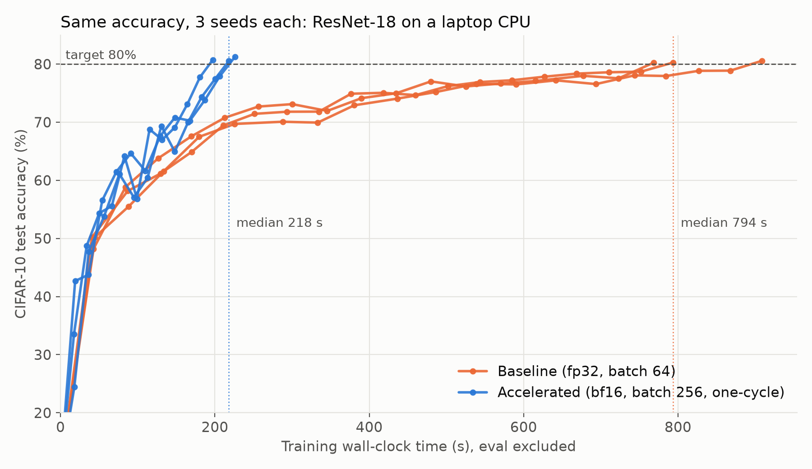
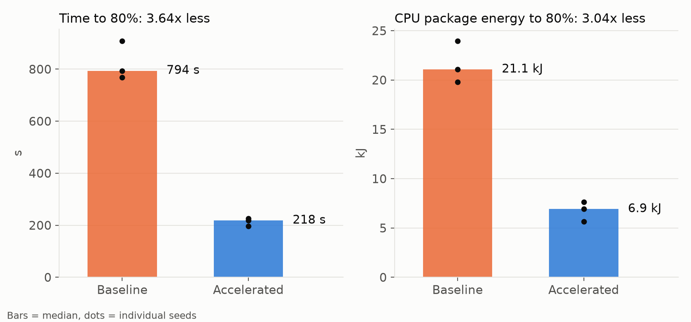
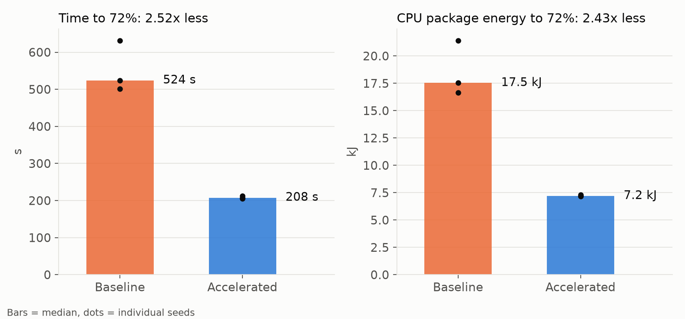
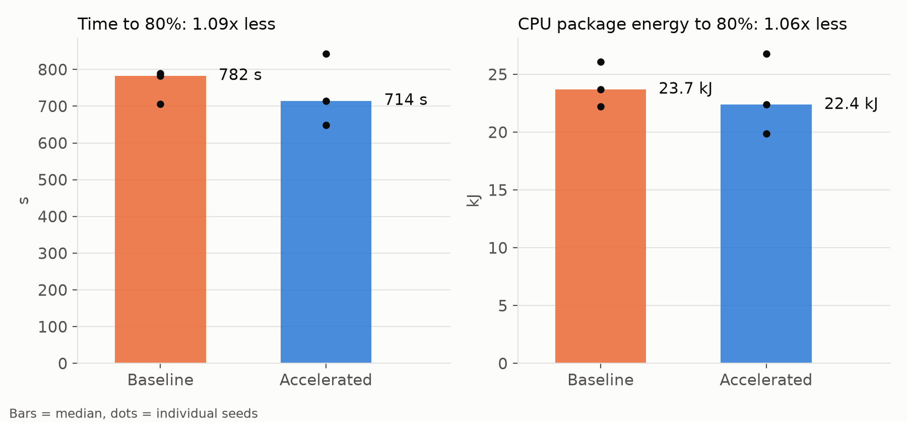

# BIOS: Faster, lower-energy PyTorch training on a laptop CPU

*By Team Prometheus.*

Train a standard PyTorch image classifier to the **same test accuracy** at least **2.5x faster** on a laptop CPU, with no GPU and no change to the model or the data. Faster training to the same result means less energy per trained model (UN SDG 7.3, energy efficiency).

**Headline (ResNet-18 on CIFAR-10, median of 3 seeds):** 80% test accuracy in **218 s instead of 794 s (3.64x faster)**, using **6.9 kJ instead of 21.1 kJ of CPU energy (3.04x less)**.



## Contents

- [Two ways to build it](#two-ways-to-build-it)
- [Results](#results)
- [What makes it faster](#what-makes-it-faster)
- [How we measure](#how-we-measure)
- [Quick start](#quick-start)
- [Reproducing the results](#reproducing-the-results)
- [Repository layout](#repository-layout)
- [Command-line options](#command-line-options)
- [Limitations](#limitations)
- [License](#license)

## Two ways to build it

The model, the data, the augmentation and the accuracy target are the same in every run. There are two ways to build the faster version, depending on whether the training settings (batch size and learning-rate schedule) are also kept. We built both and report both.

| | **Track A: systems + training settings** | **Track B: systems only** |
|---|---|---|
| What changes | Data pipeline, threads, memory layout, number precision, **batch size, learning-rate schedule** | Data pipeline, threads, memory layout, number precision, compilation, memory allocator |
| What stays the same | Model, data, augmentation, optimizer type, accuracy target | Everything in Track A's column, **plus** batch size 64 and a constant learning rate of 0.01 |
| Script | `accelerated.py` | `accelerated_sysonly.py` (refuses to run if a training setting is passed in) |

Both tracks use the same baseline (`baseline.py`) and the same harness (`bench_harness.py`) for data, evaluation, seeding, timing and energy, so all numbers are directly comparable.

## Results

All results: AMD Ryzen 7 250 (8 cores / 16 threads, AVX512-BF16), PyTorch 2.15 CPU build, Python 3.11, 3 seeds per version, median reported.

| Model | Track | Accuracy target | Baseline | Accelerated | Speedup | Energy saving |
|---|---|---|---|---|---|---|
| ResNet-18 | **A** | 80% | 794 s, 21.1 kJ | 218 s, 6.9 kJ | **3.64x** | **3.04x** |
| ShuffleNetV2 1.0 | **A** | 72% | 524 s, 17.5 kJ | 208 s, 7.2 kJ | **2.52x** | **2.43x** |
| ResNet-18 | **B** | 80% | 782 s, 23.7 kJ | 714 s, 22.4 kJ | **1.09x** | **1.06x** |
| ShuffleNetV2 1.0 | **B** | 72% | 24.4 s/epoch | 23.6 s/epoch | about 1.03x per epoch (single 2-epoch check) | |

Every 3-seed run in the table reached its accuracy target. Track A and Track B for ResNet-18 were measured in separate sessions, each against its own baseline runs. That is why the two baseline medians differ slightly (794 s and 782 s).

### Track A, ResNet-18: 3.64x faster, 3.04x less energy

| Run | Epochs to 80% | s / epoch | Time to 80% (s) | Energy (kJ) | Final accuracy |
|---|---|---|---|---|---|
| Baseline, seed 0 | 17 | 45.4 | 768.5 | 19.8 | 80.24% |
| Baseline, seed 1 | 19 | 48.0 | 908.9 | 21.1 | 80.57% |
| Baseline, seed 2 | 19 | 41.8 | 793.8 | 24.0 | 80.27% |
| Accelerated, seed 0 | 12 | 18.8 | 225.9 | 5.6 | 81.22% |
| Accelerated, seed 1 | 12 | 16.3 | 197.3 | 6.9 | 80.73% |
| Accelerated, seed 2 | 12 | 18.2 | 218.1 | 7.6 | 80.53% |

Even the worst pairing (slowest accelerated run against the fastest baseline run) is 3.40x faster and uses 2.59x less energy. Settings: bf16, channels_last, 8 threads, batch 256, one-cycle schedule with peak learning rate 0.4 over 13 epochs.



Full write-up: [docs/RESULTS_track_a.md](docs/RESULTS_track_a.md).

### Track A, ShuffleNetV2: 2.52x faster, 2.43x less energy

A second, very different architecture (a mobile-style network built from depthwise convolutions), with the same data, harness and protocol. The target is 72%, the level its baseline reaches in 21–26 epochs.

| Run | Epochs to 72% | s / epoch | Time to 72% (s) | Energy (kJ) | Final accuracy |
|---|---|---|---|---|---|
| Baseline, seed 0 | 26 | 24.3 | 631.8 | 21.4 | 73.44% |
| Baseline, seed 1 | 21 | 25.0 | 523.8 | 16.6 | 72.91% |
| Baseline, seed 2 | 21 | 23.8 | 501.4 | 17.5 | 72.43% |
| Accelerated, seed 0 | 14 | 15.1 | 212.0 | 7.2 | 73.09% |
| Accelerated, seed 1 | 14 | 14.6 | 205.3 | 7.2 | 73.33% |
| Accelerated, seed 2 | 14 | 14.8 | 207.6 | 7.3 | 72.44% |

Plain 32-bit floats were fastest for this model (14.8 s/epoch, against 16.4 s with bf16 + channels_last and 24.0 s with bf16 alone), so this result needs no special number format. The worst pairing is 2.37x.



### Track B, ResNet-18: 1.09x faster with the training settings kept

| Run | Epochs to 80% | s / epoch | Time to 80% (s) | Energy (kJ) | Final accuracy |
|---|---|---|---|---|---|
| Baseline, seed 0 | 17 | 41.5 | 706.3 | 22.2 | 80.24% |
| Baseline, seed 1 | 19 | 41.6 | 789.6 | 23.7 | 80.57% |
| Baseline, seed 2 | 19 | 41.1 | 782.2 | 26.1 | 80.27% |
| Track B, seed 0 | 19 | 34.0 | 648.6 | 19.9 | 80.23% |
| Track B, seed 1 | 25 | 33.6 | 843.4 | 26.8 | 80.17% |
| Track B, seed 2 | 21 | 33.8 | 714.4 | 22.4 | 80.02% |

Epochs ran 1.22x faster (33.8 s against 41.4 s), but the Track B runs needed 19–25 epochs to cross 80%, against 17–19 for the baseline. Settings: bf16, channels_last, 8 threads, in-memory data pipeline, chosen from an 11-configuration timing sweep.



Full write-up, including the sweep: [docs/RESULTS_track_b.md](docs/RESULTS_track_b.md).

### What the two tracks show together

With both the execution and the training settings optimised, the 2.5x goal is exceeded on two architectures (3.64x and 2.52x). With the training settings kept, the same system-level work gives about 1.1x on this hardware. On a laptop CPU, the batch size and learning-rate schedule account for most of the reachable speedup.

## What makes it faster

The Track A speedup on ResNet-18 is two factors that multiply: **epochs about 2.5x faster** (45 s to 18 s) and **about 1.5x fewer epochs** (12 instead of 17–19).

| # | Change | Track | Effect measured on ResNet-18 |
|---|---|---|---|
| 1 | **In-memory data pipeline.** The whole dataset is one uint8 tensor in RAM. Crop, flip and normalise run per batch in PyTorch: no PIL, no DataLoader worker processes competing for cores. | A, B | Data loading disappears from the profiler |
| 2 | **8 threads, one per physical core.** Hyper-threaded siblings share the same vector units. | A, B | 27.0 s/epoch against 40.5 s with 16 threads |
| 3 | **bf16 autocast.** Uses the CPU's native AVX512-BF16 instructions. Weights, batch-norm and the optimizer stay in fp32. | A, B | 16.3 against 24.0 s/epoch (1.47x); 568 against 836 J/epoch |
| 4 | **channels_last layout + fused SGD**, one loss sync per epoch | A, B | Matches oneDNN's native convolution layout |
| 5 | **Batch 256** instead of 64, learning rate scaled linearly, 1-epoch warmup | A | 23.3 against 27.0 s/epoch (batch 256 against 128) |
| 6 | **One-cycle learning-rate schedule** (peak 0.4, annealed to near zero) instead of a constant rate | A | 12 epochs to 80% instead of 17–19 |

**Tried and not used**, because they measured slower or offered too little:

| Idea | Result |
|---|---|
| `torch.compile` | Track A: 17.2 against 16.3 s/epoch. Track B: 34.1 s (35.7 s in max-autotune mode) against 33.2 s. Convolutions are about 64% of step time and already run in oneDNN. |
| 16 threads | 40.5 against 27.0 s/epoch |
| 4 or 6 threads at batch 64 | 34.7–40.0 against 31.3 s/epoch |
| jemalloc allocator | 46.8 against 33.2 s/epoch |
| Custom C++ kernels | Not built: the profiler showed data loading near 0% and memory copies around 15% |
| FP16 | Not tried: this CPU has no native FP16 arithmetic |

## How we measure

- **Time to target accuracy**, not images per second. A faster step that needs more epochs does not count as a win.
- **One shared harness** (`bench_harness.py`) for data, augmentation, evaluation, seeding, timing and energy, so baseline and accelerated code cannot drift apart.
- **Real CIFAR-10:** 50,000 training and 10,000 held-out test images, RandomCrop(32, padding 4) + horizontal flip.
- **Evaluation runs after every epoch and is excluded from the clock** for both versions. A run stops at the first epoch whose test accuracy reaches the target.
- **3 seeds per version, alternated** (baseline, accelerated, baseline, ...) with 2-minute cooldowns, laptop plugged in. We report the median and the worst-case pairing.
- **Energy** comes from the CPU's RAPL counters (CPU package only), measured over the same training-only window for both versions.
- **Every result file records its full configuration and environment** (PyTorch version, CPU, thread count, flags).

## Quick start

Requirements: Linux, Python 3.10+, about 1 GB of free disk space. The scripts in `scripts/` use the [fish shell](https://fishshell.com/); the Python commands work in any shell.

```bash
git clone <this-repo-url> bios
cd bios
python -m venv .venv && source .venv/bin/activate
pip install -r requirements.txt

# Optional: let the energy meter read the CPU's RAPL counters (until next reboot)
sudo chmod a+r /sys/class/powercap/intel-rapl:*/energy_uj

# Quick smoke test on random data (checks the install, no download)
python accelerated.py --synthetic --max-epochs 1 --out-dir results/smoke
```

The first real run downloads CIFAR-10 (about 120 MB, from the Hugging Face mirror) and caches it as `data/cifar10_uint8.pt`. Later runs load the cache. Use `--source torchvision` to download from the original Toronto server instead.

## Reproducing the results

Run everything from the repository root, plugged in, in performance power mode, with nothing else open. The proof scripts run the RAPL `sudo chmod` for you, and move any existing output folder aside as `<folder>_old_<time>` before starting.

| Command | What it runs | Time | Writes to |
|---|---|---|---|
| `fish scripts/proof_track_a.fish` | ResNet-18, Track A, 3 seeds alternating | about 1–1.5 h | `results/track_a/`, `plots/track_a/` |
| `fish scripts/sweep_track_b.fish` | Track B timing sweep, 2 epochs per configuration | about 20–25 min | `results/track_b_sweep/` |
| `fish scripts/sweep_track_b_threads.fish` | Track B thread-count and layout sweep | about 6–8 min | `results/track_b_sweep/` |
| `fish scripts/proof_track_b.fish` | ResNet-18, Track B, 3 seeds alternating | about 1.5–2 h | `results/track_b/`, `plots/track_b/` |
| `fish scripts/proof_shufflenet.fish` | ShuffleNetV2, Track A, 3 seeds alternating | about 1 h | `results/shufflenet_v2_x1_0/track_a/` |
| `fish scripts/proof_shufflenet_track_b.fish` | ShuffleNetV2, Track B, 3 seeds alternating | about 1.5–2 h | `results/shufflenet_v2_x1_0/track_b/` |

Single runs, for example one baseline seed:

```bash
python baseline.py --seed 0 --target-acc 0.80 --out-dir results/track_a
python accelerated.py --channels-last --bf16 --schedule onecycle --threads 8 \
    --batch-size 256 --base-lr 0.1 --max-epochs 13 --seed 0 --target-acc 0.80 --out-dir results/track_a
python accelerated_sysonly.py --channels-last --bf16 --threads 8 --seed 0 --target-acc 0.80 --out-dir results/track_b
```

Summarise and plot any results folder (no training, takes seconds):

```bash
python summarize.py results/track_a              # markdown table: time, speedup, energy, accuracy
python make_plots.py results/track_a plots/track_a
```

## Repository layout

```
.
├── bench_harness.py           # shared: data, augmentation, evaluation, seeds, threads, timing, RAPL energy
├── baseline.py                # baseline job, shared by both tracks
├── accelerated.py             # Track A: systems + training settings
├── accelerated_sysonly.py     # Track B: systems only (batch size and learning rate locked)
├── summarize.py               # results folder -> markdown table
├── make_plots.py              # results folder -> accuracy-vs-time and time/energy figures
├── requirements.txt
├── LICENSE                    # MIT
├── scripts/                   # one-command proof runs and sweeps (fish shell)
├── results/                   # raw per-run JSON results, see results/README.md
├── plots/                     # figures generated by make_plots.py
├── docs/
│   ├── RESULTS_track_a.md     # Track A write-up
│   └── RESULTS_track_b.md     # Track B write-up and timing sweep
└── data/                      # CIFAR-10 cache, created on first run (not committed)
```

## Command-line options

Shared by all three training scripts (`bench_harness.common_args`):

| Option | Default | Meaning |
|---|---|---|
| `--seed` | 0 | Random seed |
| `--target-acc` | 0.80 | Stop at the first epoch whose test accuracy reaches this |
| `--max-epochs` | 40 | Give up after this many epochs (`reached: false` in the result) |
| `--threads` | physical cores | Intra-op threads (`BENCH_THREADS` environment variable also works) |
| `--model` | `resnet18` | `resnet18`, `shufflenet_v2_x1_0`, `squeezenet1_1`, `mobilenet_v3_small` (stock torchvision, 10 classes) |
| `--data` | `./data` | Dataset cache folder |
| `--source` | `hf` | `hf` (Hugging Face mirror) or `torchvision` (Toronto server) |
| `--out-dir` | `results` | Folder for the result JSON |
| `--tag` | | Suffix for the result file name, e.g. `--tag t16` gives `accelerated_t16_seed0.json` |
| `--synthetic` | off | Random data, for smoke tests only |

`baseline.py` also takes `--batch-size` (64), `--lr` (0.01) and `--workers` (2).

`accelerated.py` also takes:

| Option | Default | Meaning |
|---|---|---|
| `--batch-size` | 256 | Batch size; learning rate is scaled by `batch_size / 64` |
| `--base-lr` | 0.01 | Learning rate at batch 64 |
| `--schedule` | `none` | `none`, `cosine` or `onecycle` |
| `--warmup-epochs` | 1.0 | Linear warmup length (for `none` and `cosine`) |
| `--epochs-for-schedule` | `--max-epochs` | Schedule length, if different from `--max-epochs` |
| `--channels-last` | off | NHWC memory layout |
| `--bf16` | off | bf16 autocast (needs AVX512-BF16 or AMX to help) |
| `--compile`, `--compile-mode` | off, `default` | `torch.compile` the model |
| `--flush-denormal` | off | Treat denormal floats as zero |
| `--name` | `accelerated` | Prefix of the result file name |
| `--profile` | off | Profile 30 training steps, print the top operations, exit |

`accelerated_sysonly.py` takes the same options as `accelerated.py`, except `--batch-size`, `--base-lr`, `--schedule`, `--warmup-epochs` and `--epochs-for-schedule`, which it fixes to the baseline's values (64, 0.01, none, 0). It exits with an error if any of these are passed.

## Limitations

- **One machine.** All numbers come from one AMD Ryzen 7 250 laptop. The bf16 gain depends on native bf16 support, which many laptop CPUs lack; the data pipeline, threading, batch size and schedule changes do not depend on it. The ShuffleNetV2 result uses no bf16.
- **Laptop timing is noisy.** Two identical baseline runs took 731 s and 996 s on different occasions. Alternating runs, cooldowns, medians and worst-case pairings are used to account for this.
- **Energy covers the CPU package only.** It excludes memory, display and the rest of the laptop, and is measured the same way for both versions.
- **3 seeds per version.** ResNet-18 accuracy margins are small (final accuracy 80.2–81.2%), since 80% is close to what this architecture reaches on 32×32 images in this training budget.
- **ShuffleNetV2 Track B** has a single 2-epoch timing check so far; the full 3-seed run is `scripts/proof_shufflenet_track_b.fish`. SqueezeNet 1.1 was also tried and did not learn with the baseline settings (accuracy stayed at 10%), so it is not reported.

## License

[MIT](LICENSE) © 2026 Team Prometheus
