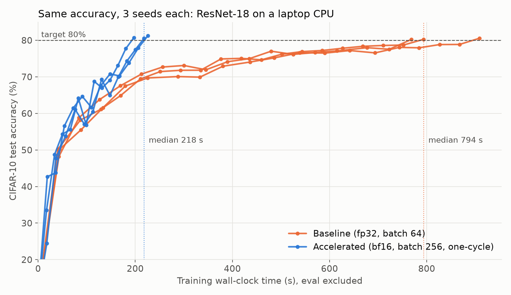
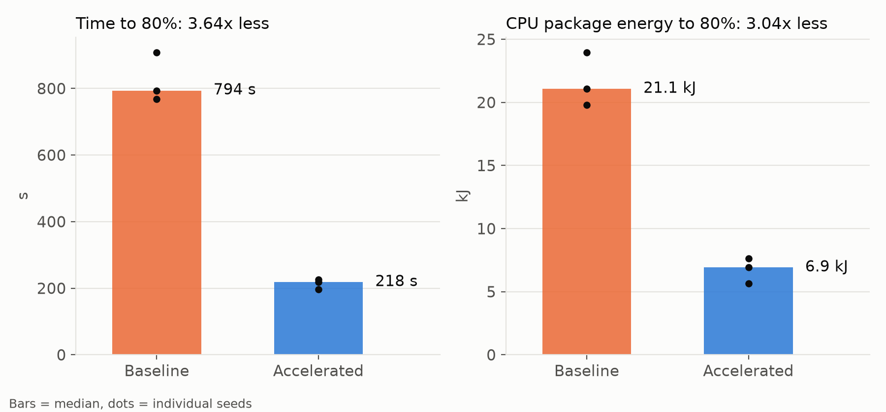

# BIOS Track A: ResNet-18 training 3.6x faster on a laptop CPU, same accuracy, 3x less energy

**Hardware:** AMD Ryzen 7 250 (8 cores / 16 threads, AVX512-BF16), PyTorch 2.15 CPU, 8 intra-op threads
**Task:** ResNet-18 (torchvision, unchanged) on CIFAR-10 (50k train / 10k test, RandomCrop(32,4) + HFlip, unchanged), trained until test accuracy ≥ 80%
**Protocol:** 3 seeds each, baseline and accelerated alternated with 2-minute cooldowns, laptop plugged in. Time is training wall-clock (eval excluded for both). Energy is CPU package energy from RAPL.

## Headline

| Metric (median of 3 seeds) | Baseline | Accelerated | Improvement | Worst case* |
|---|---|---|---|---|
| Time to 80% test accuracy | 794 s | 218 s | **3.64x faster** (−73%) | 3.40x |
| Energy to 80% | 21.1 kJ | 6.9 kJ | **3.04x less** (−67%) | 2.59x |
| Final test accuracy (mean) | 80.36% | 80.83% | +0.47 pp | all 6 runs ≥ 80% |
| Epochs needed | 17–19 | 12 | | |
| Seconds per epoch | 45.4 | 18.2 | 2.49x | |

*Worst case = slowest/most energy-hungry accelerated seed against the fastest/most frugal baseline seed. The 2.5x goal holds even then.




## Per-seed results

| Run | Epochs | s/epoch | Time to 80% (s) | Energy (J) | Final acc |
|---|---|---|---|---|---|
| baseline seed 0 | 17 | 45.4 | 768.5 | 19,784 | 80.24% |
| baseline seed 1 | 19 | 48.0 | 908.9 | 21,084 | 80.57% |
| baseline seed 2 | 19 | 41.8 | 793.8 | 23,974 | 80.27% |
| accelerated seed 0 | 12 | 18.8 | 225.9 | 5,637 | 81.22% |
| accelerated seed 1 | 12 | 16.3 | 197.3 | 6,927 | 80.73% |
| accelerated seed 2 | 12 | 18.2 | 218.1 | 7,624 | 80.53% |

## Where the speedup comes from

The 3.64x splits into **~2.5x faster epochs** × **~1.5x fewer epochs**.

**Faster epochs (45 s → 18 s):**

| Change | What it does | Measured |
|---|---|---|
| In-memory, vectorised data pipeline | Whole dataset held as one uint8 tensor. Crop/flip/normalise run per batch in torch, so there are no PIL calls, no DataLoader workers, and no cores stolen from compute | Data loading no longer appears in the profiler |
| 8 threads (physical cores) | SMT siblings fight over the same AVX-512 units | 8 threads: 27.0 s/epoch vs 16 threads: 40.5 s |
| Batch 256 (LR scaled linearly) | Fewer optimizer steps, better GEMM efficiency, less per-step overhead | 23.3 vs 27.0 s/epoch (batch 256 vs 128, both bf16, same session) |
| bf16 autocast | Uses the CPU's native AVX512-BF16 dot-product instructions. Weights, BN and optimizer stay fp32 | 16.3 vs 24.0 s/epoch (1.47x), 568 vs 836 J/epoch |
| channels_last | Matches oneDNN's native NHWC conv layout, avoiding per-layer reorders | Used throughout |
| Fused SGD, one loss sync per epoch | Avoids a per-step `loss.item()` round-trip | Small |

**Fewer epochs (17–19 → 12):** one-cycle LR schedule (warm up to peak LR 0.4, then anneal to ~0) instead of a constant LR. Accuracy jumps in the final low-LR epochs (see the plot).

**Tried and rejected:** `torch.compile`. It is slower or equal on this CPU (17.2 vs 16.3 s/epoch), even after fixing a recompile caused by the odd-sized last batch. Convolutions are about 64% of step time and already run in oneDNN, so there was little left to fuse.

## Why it matters (SDG 7.3: energy efficiency)

Each training run to the same accuracy uses about 14 kJ less CPU energy (−67%). Because the CPU finishes and idles sooner ("race to idle"), shorter training translates directly into lower energy. The method needs no new hardware, no GPU and no change to the model or data: it is a recipe any student or small lab can apply to existing CPU training.

## Limitations

- **Systems vs training settings.** Batch size and the LR schedule are training settings; the model and data are unchanged. The per-epoch gains (bf16, data pipeline, threads, layout) are pure systems work. Track B measures that part on its own, with batch size and learning rate kept at the baseline's values: see [RESULTS_track_b.md](RESULTS_track_b.md).
- **n = 3 seeds.** All 6 runs crossed 80%, but the margin is small (80.5–81.2%), because 80% is close to this architecture's ceiling on 32×32 images.
- **Laptop timing noise is real.** Identical baseline runs ranged from 731 s to 996 s across the day. That is why results use alternating runs and medians, and why worst-case ratios are quoted.
- **Energy covers the CPU package only** (RAPL). It excludes DRAM, display and the rest of the system, and is the same measurement for both sides.

## Reproduce

```fish
pip install -r requirements.txt
fish scripts/proof_track_a.fish      # about 1-1.5 h; writes results/track_a and plots/track_a
```
