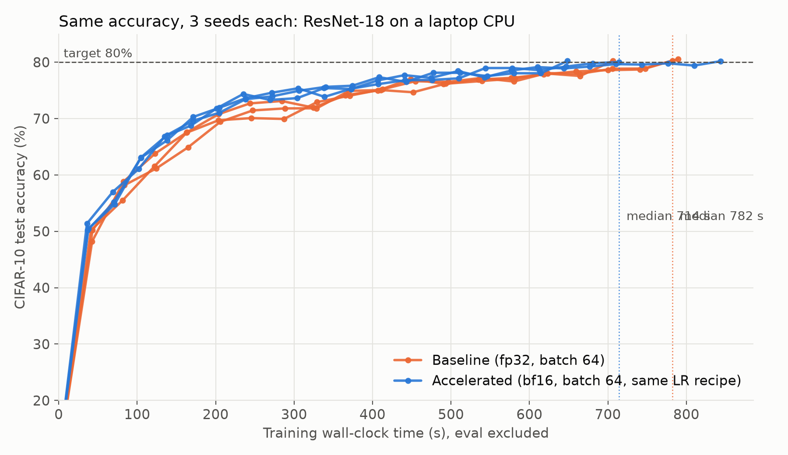
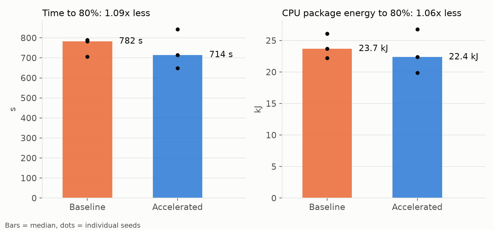

# BIOS Track B: systems-only acceleration, training settings kept

**Hardware:** AMD Ryzen 7 250 (8 cores / 16 threads, AVX512-BF16), PyTorch 2.15 CPU
**Task:** ResNet-18 (torchvision, unchanged) on CIFAR-10 (50k train / 10k test, RandomCrop(32,4) + HFlip, unchanged), trained until test accuracy ≥ 80%
**Kept from the baseline:** batch size 64, SGD with constant learning rate 0.01, momentum 0.9, weight decay 5e-4, no warmup, no schedule. `accelerated_sysonly.py` enforces this and exits if any of these settings are passed in.
**Free to change:** how the computation runs: data pipeline, threads, memory layout, number precision, compilation, memory allocator.
**Protocol:** identical to Track A: 3 seeds each, baseline and Track B alternated with 2-minute cooldowns, laptop plugged in, evaluation excluded from the clock, CPU package energy from RAPL.

## Headline

| Metric (median of 3 seeds) | Baseline | Track B | Improvement |
|---|---|---|---|
| Time to 80% test accuracy | 782 s | 714 s | **1.09x faster** |
| Energy to 80% | 23.7 kJ | 22.4 kJ | **1.06x less** |
| Seconds per epoch | 41.4 | 33.8 | 1.22x |
| Epochs needed | 17–19 | 19–25 | |

Settings used: bf16 autocast, channels_last, 8 threads, in-memory vectorised data pipeline, fused SGD.




## Per-seed results

| Run | Epochs | s/epoch | Time to 80% (s) | Energy (J) | Final acc |
|---|---|---|---|---|---|
| baseline seed 0 | 17 | 41.5 | 706.3 | 22,206 | 80.24% |
| baseline seed 1 | 19 | 41.6 | 789.6 | 23,693 | 80.57% |
| baseline seed 2 | 19 | 41.1 | 782.2 | 26,103 | 80.27% |
| Track B seed 0 | 19 | 34.0 | 648.6 | 19,893 | 80.23% |
| Track B seed 1 | 25 | 33.6 | 843.4 | 26,801 | 80.17% |
| Track B seed 2 | 21 | 33.8 | 714.4 | 22,370 | 80.02% |

Raw files: [`results/track_b/`](../results/track_b/).

## Timing sweep

Before the proof runs, each systems-only configuration was trained for 2 epochs at batch 64 (seed 0). The table compares epoch 2, since epoch 1 includes warm-up and compilation. Raw files: [`results/track_b_sweep/`](../results/track_b_sweep/).

| Configuration | Threads | Epoch-2 time (s) | Epoch-2 energy (J) |
|---|---|---|---|
| fp32 | 8 | 35.1 | 1,225 |
| fp32 + channels_last | 8 | 39.7 | 1,385 |
| bf16 + channels_last | 8 | 33.2 | 1,158 |
| bf16 + channels_last + flush-denormal | 8 | 32.9 | 1,146 |
| bf16 + flush-denormal (no channels_last) | 8 | **31.3** | 1,093 |
| bf16 + channels_last + flush-denormal | 6 | 34.7 | 1,213 |
| bf16 + channels_last + flush-denormal | 4 | 40.0 | 1,396 |
| bf16 + flush-denormal (no channels_last) | 4 | 37.4 | 1,305 |
| bf16 + channels_last + `torch.compile` | 8 | 34.1 | 1,196 |
| bf16 + channels_last + `torch.compile` (max-autotune) | 8 | 35.7 | 997 |
| bf16 + channels_last + jemalloc | 8 | 46.8 | 1,306 |

Observations:

- **bf16 helps; channels_last only helps together with bf16.** In fp32 at batch 64, channels_last is slower (39.7 against 35.1 s).
- **8 threads is the best thread count.** 4 and 6 threads are slower; Track A showed 16 threads are slower too.
- **`torch.compile` and jemalloc do not help** on this CPU at batch 64.
- The differences between the top bf16 configurations (31.3–33.2 s) are within one or two seconds per epoch. The proof runs used bf16 + channels_last at 8 threads.

## Why the end-to-end gain is small

- **Small operations at batch 64.** Stock ResNet-18 shrinks a 32×32 image to 1×1 by its last block. At batch 64, each operation in the late layers is too small to keep 8 cores busy, so fixed per-step overhead dominates. Track A's batch of 256 gives each operation 4x more work, which is a large part of why its epochs scale further.
- **Convolutions already run in an optimised library.** The profiler shows convolutions take about 64% of each step, and they already run in oneDNN. Even if everything else took zero time, the step would only get about 1.6x faster.
- **Epoch count is unchanged in expectation.** With a constant learning rate, accuracy hovers around 78–80% for several epochs, so the epoch at which a run first crosses 80% varies between seeds. Track B runs needed 19–25 epochs against 17–19 for the baseline; with 3 seeds, this cannot be separated from a small effect of bf16 on learning.

## ShuffleNetV2 check

A single 2-epoch run of ShuffleNetV2 1.0 with the same kept settings (batch 64, 8 threads, fp32, in-memory pipeline) averaged 23.6 s per epoch, against 24.4 s for the ShuffleNetV2 baseline: about 1.03x per epoch. Raw file: [`results/shufflenet_v2_x1_0/track_b_sweep/`](../results/shufflenet_v2_x1_0/track_b_sweep/). The full 3-seed run is `scripts/proof_shufflenet_track_b.fish`.

## Reproduce

```fish
pip install -r requirements.txt
fish scripts/sweep_track_b.fish           # about 20-25 min; writes results/track_b_sweep
fish scripts/sweep_track_b_threads.fish   # about 6-8 min; writes results/track_b_sweep
fish scripts/proof_track_b.fish           # about 1.5-2 h; writes results/track_b and plots/track_b
```
